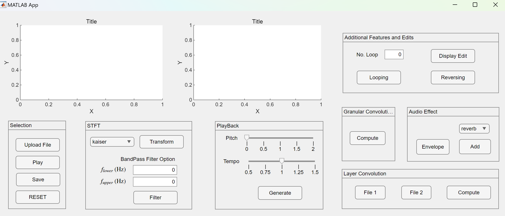
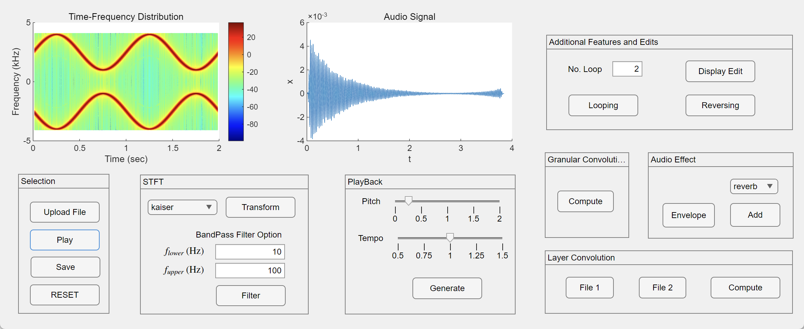
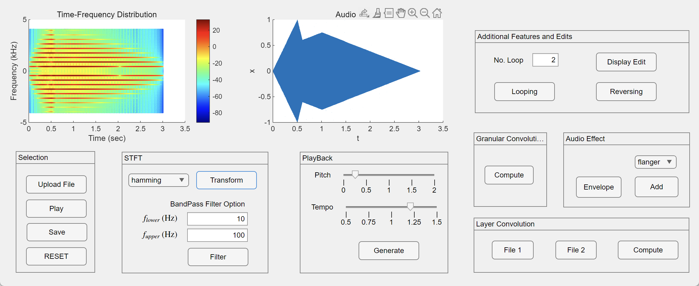

# MATLAB Audio Synthesis GUI

**오디오 신호를 시각화하고, 필터·시간 변형·음향 효과를 실험하는 MATLAB GUI 프로젝트입니다.**

원 프로젝트명: *Granular Convolution-Based Audio Synthesis GUI*  
작성자: 이정환 · 전자공학부 전자시스템공학전공  
프로젝트 기간: **2024.09 ~ 2024.11**

WAV 파일을 불러온 뒤 시간 영역 파형과 STFT 스펙트로그램을 확인하고, 다양한 신호 처리 기법을 한 화면에서 적용할 수 있도록 구성했습니다. 학습 프로젝트의 소스와 발표 자료를 정리한 저장소입니다.



> 화면 이미지는 기존 발표 자료에서 추출한 프로젝트 실행 화면입니다. 현재 저장소 정리 과정에서 새로 실행한 결과는 아닙니다.

## 주요 기능

| 영역 | 기능 | 구현 |
| --- | --- | --- |
| 파일 관리 | WAV 불러오기·재생·저장·초기화 | `audioread`, `sound`, `audiowrite` |
| 시간–주파수 분석 | STFT 스펙트로그램, Kaiser/Hamming/Hann 윈도우 선택 | `stft`, `mesh` |
| 주파수 필터링 | 하한·상한 주파수를 지정하는 대역 통과 필터 | `bandpass` |
| 재생 변형 | 피치 비율·템포 조절 | Phase vocoder, `resample` |
| 그레인 처리 | 짧은 Hann 윈도우 그레인의 무작위 배치 | `ST_granular_Conv`, `grainSh` |
| 레이어 결합 | 두 오디오 신호의 선형 컨볼루션 | `conv` |
| 음향 효과 | 리버브·플랜저·FM 합성음 추가 | `reverberator`, `flanger`, `synth` |
| 편집 | 반복·역재생·자유 영역 스펙트로그램 마스킹 | `flipud`, `drawfreehand`, `istft` |

GUI의 `Granular Convolution`은 원래 명칭을 유지했습니다. 실제 구현은 무작위 그레인 추출·배치이며, 두 신호에 `conv`를 적용하는 기능은 `Layer Convolution`입니다. `Envelope` 버튼은 FM 합성음을 기존 신호에 더합니다.

## 실행 환경

- MATLAB 데스크톱과 App Designer 기반 UI 지원 환경
- **Signal Processing Toolbox**: 리샘플링, STFT/ISTFT, 윈도우, 필터링
- **Audio Toolbox**: `reverb` 효과 사용 시 필요
- **Image Processing Toolbox**: `Display Edit` 사용 시 필요

원본 자료에 MATLAB 릴리스가 기록되어 있지 않아 최소 지원 버전은 확정하지 않았습니다. Octave용 GUI가 아닙니다.

## 빠른 시작

1. 이 저장소를 내려받습니다.
2. MATLAB에서 저장소 최상위 폴더를 Current Folder로 선택합니다.
3. Command Window에서 다음을 실행합니다.

```matlab
app = run_app;
```

`run_app`은 소스 경로와 주요 함수의 존재 여부를 확인한 뒤 GUI를 엽니다. 필요한 도구상자의 실제 라이선스 사용 가능 여부까지 보장하지는 않습니다.

### 첫 실험

원본 ZIP에는 오디오 샘플이 없습니다. 직접 만든 **모노 WAV**를 사용하거나, 아래 명령으로 2초짜리 합성 데모를 만드세요.

```matlab
run(fullfile('examples', 'generate_demo_audio.m'))
app = run_app;
```

1. **Upload File**에서 `examples/demo.wav`를 선택합니다.
2. **Play**로 파형을 확인하고, **Transform**으로 스펙트로그램을 표시합니다.
3. 예를 들어 하한 `200`, 상한 `1000` Hz를 입력한 뒤 **Filter**를 누릅니다.
4. 다시 **Play / Transform**을 눌러 결과를 비교합니다.
5. **Save**로 결과를 저장합니다. 원본 저장 콜백의 제약 때문에 파일은 **MATLAB Current Folder**에 저장됩니다. 원하는 폴더를 Current Folder로 설정한 후 저장하세요.

입력은 8,192 Hz로 리샘플링됩니다. 필터 범위는 `0 < 하한 < 상한 < 4096` Hz로 지정하세요. 효과는 현재 신호에 누적 적용되므로 새 실험은 **Upload File**로 원본을 다시 불러와 시작하는 것이 좋습니다.

## 결과 화면

### 피치·템포·반복·필터링 실험



### 음향 효과 실험



정량 성능 측정이나 음질 비교 수치는 원본 자료에 포함되어 있지 않습니다.

## 저장소 구성

| 경로 | 내용 |
| --- | --- |
| [`run_app.m`](run_app.m) | 경로 설정·주요 의존성 확인·GUI 실행 |
| [`src/GUI_NOV.m`](src/GUI_NOV.m) | UI 구성 및 기능별 콜백 |
| `src/pvoc.m`, `pvsample.m`, `pvstft.m`, `pvistft.m` | Phase vocoder 관련 함수 |
| `src/ST_granular_Conv.m`, `grainSh.m` | 그레인 기반 오디오 처리 |
| `src/flanger.m`, `synth.m` | 플랜저 및 합성음 생성 |
| [`src/schroeder1.m`](src/schroeder1.m) | 별도 리버브 실험 코드; GUI에서는 미사용 |
| [`examples/generate_demo_audio.m`](examples/generate_demo_audio.m) | 외부 음원 없이 데모 WAV 생성 |
| [`docs/report/project-report.pptx`](docs/report/project-report.pptx) | 학번·작성자 메타데이터를 제거한 발표 자료 |
| [`docs/KNOWN_ISSUES.md`](docs/KNOWN_ISSUES.md) | 원본 구현의 제약과 수동 검증 항목 |
| [`THIRD_PARTY_NOTICES.md`](THIRD_PARTY_NOTICES.md) | 참고 코드 출처 및 권리 관련 기록 |

## 구현 및 검증 범위

기존 `.m` 파일 10개는 원본 그대로 보존했습니다. 저장소 정리 시 실행 진입점, 데모 생성 스크립트, 문서, Git 제외 규칙을 추가했습니다. 학번을 제거한 발표 자료와 기존 GUI 이미지를 함께 제공합니다.

정리 환경에 MATLAB이 설치되어 있지 않아 **GUI 실행과 음향 처리 결과는 재검증하지 않았습니다**. 파일 무결성, 문서의 상대 경로, 개인정보 제거 여부를 점검했습니다. 스테레오 입력, 파일 선택 취소, RESET, 짧은 입력 등에는 알려진 제약이 있습니다. 자세한 내용은 [알려진 제약](docs/KNOWN_ISSUES.md)을 참고하세요.

## 참고 코드와 라이선스

Phase vocoder 관련 파일에는 Dan Ellis의 원본 작성자 표기가 포함되어 있습니다. 출처를 유지했으며, 프로젝트 전체에 임의의 오픈소스 라이선스를 지정하지 않았습니다. 자세한 내용은 [THIRD_PARTY_NOTICES.md](THIRD_PARTY_NOTICES.md)에 정리했습니다.
